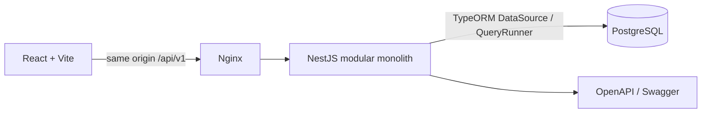

# Архитектура SpaceOps

## Компоненты

React Router отвечает за разделы, TanStack Query — за серверные данные, опрос раз в 30 секунд и инвалидацию после мутаций. React Hook Form + Zod проверяют формы; сервер независимо валидирует все изменяемые поля. UI-компоненты Button и Dialog следуют подходу shadcn/ui, Radix Dialog управляет фокусом и доступностью модальных окон. SVG строится по геометрии из базы. FullCalendar использует Luxon для именованного часового пояса, Recharts — агрегаты API.

NestJS разделён на модули Auth, Users, Spaces, Bookings, Equipment, Tickets, Relocations, Notifications, Analytics, Audit. `DatabaseModule` предоставляет TypeORM DataSource и явные транзакции QueryRunner. Важные запросы написаны SQL, чтобы ограничения диапазонов и блокировки были видимы в коде. Схема меняется только миграциями, `synchronize: false`.

## Транзакции и порядок блокировок

1. Прочитать текущее помещение бронирования без блокировки.
2. Заблокировать все затронутые пространства через `FOR UPDATE ORDER BY id`.
3. Прочитать бронирование с `FOR UPDATE`, проверить, что его помещение ещё соответствует первоначальному чтению.
4. Проверить владельца, статус и `version`. При изменении пространства/версии вернуть 409, не продолжать по устаревшим данным.
5. При ответе на предложение заблокировать предложение после бронирования.
6. Повторно проверить доступность и оборудование; выполнить изменения, аудит и уведомления.
7. Commit; при ошибке — rollback всего изменения.

Порядок «пространства → бронирование → предложение» одинаков у создания, изменения, отмены, ограничения и переноса. Блокировка помещения также сначала блокирует пространство, затем меняет затронутые бронирования. Это предотвращает взаимную блокировку при конкурентном редактировании и закрытии комнаты.

`bookings_no_overlap` — дополнительная гарантия БД для любого клиента. Интервалы полуоткрытые: конец одной встречи может совпадать с началом другой. SQLSTATE `23P01` преобразуется в HTTP 409.

## Переносы

- Блокировка увеличивает `version` затронутых активных встреч и выставляет `needs_relocation`.
- Предложение содержит версию встречи на момент отправки. Предыдущее ожидающее предложение становится недействительным.
- Альтернативы сортируются: тот же этаж, затем другой, далее вместимость и название.
- Только владелец может принять или отклонить предложение, включая встречи диспетчера и администратора.
- Подтверждение повторно проверяет ограничения и переводит исходную запись в новую комнату; новая бронь-дубликат не создаётся.
- Отказ сохраняет исходное бронирование с признаком проблемы. Комната остаётся недоступной.
- Изменение, отмена или новое ограничение аннулирует ожидающее предложение.
- Снятие последней пересекающейся блокировки убирает признак проблемы. Принятые переносы не откатываются.

## Безопасность

Глобальный guard загружает сессию по SHA-256 хешу случайного токена и текущую роль из БД. Хеширование паролей — Argon2id. Сессия действует 7 дней; выход удаляет её. Cookie `HttpOnly`, `SameSite=Strict`, `Secure` включается для HTTPS. Для мутаций обязательны точный Origin и CSRF-токен из читаемой cookie, хеш которого хранится в сессии. Login проверяет Origin и ограничивается 30 запросами за 15 минут на IP; для неизвестной почты тоже вычисляется Argon2 verify, а текст ошибки одинаков.

Backend не выдаёт сотруднику чужие комментарии/названия/требования встреч, а обращения и их комментарии доступны автору и управляющим ролям. Редактировать встречу может только её владелец, отменять — владелец либо диспетчер/администратор. Изменить роли может только администратор, последнего администратора нельзя лишить этой роли.

В логах не печатаются параметры SQL и исключения, которые могут включать хеши, токены или частные тексты. API в production доступен через один доверенный nginx, который перезаписывает X-Forwarded-For. Секреты — переменные окружения, `.env` не включается в Git.

## Аналитика

Рабочие окна 08:00–22:00 строятся по локальным календарным датам площадки, затем переводятся в `timestamptz`. PostgreSQL `range_agg` объединяет блокировки, multirange-вычитание исключает их из доступных минут. Числитель — пересечение активных бронирований с оставшимися рабочими сегментами, без заблокированных минут. Если знаменатель равен нулю, `utilization` равен `null` и UI показывает «Нет данных».

Статистика отражает бронирования, а не посещаемость. Активные/отменённые встречи считаются по пересечению с периодом; открытые обращения — текущий backlog; среднее время решения — по обращениям, решённым в выбранном периоде.

## Технические источники

- [PostgreSQL: range types and exclusion constraints](https://www.postgresql.org/docs/current/rangetypes.html).
- [NestJS: database integration](https://docs.nestjs.com/techniques/database).
- [Vite: Getting Started](https://vite.dev/guide/).
