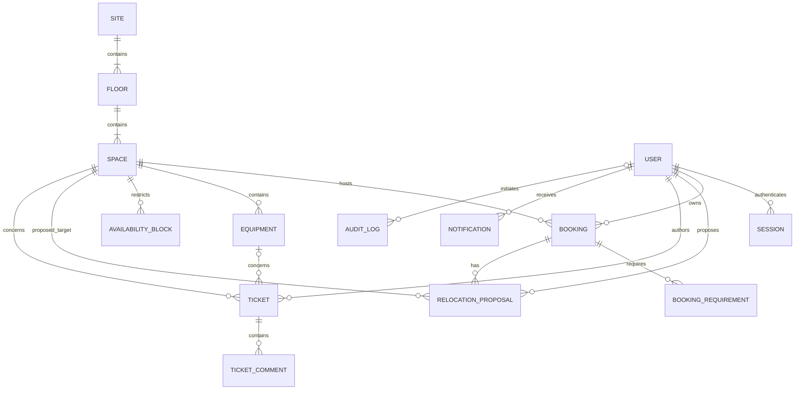

# Схема данных

Полная схема и CHECK/FK-ограничения: `apps/api/src/database/migrations/1700000000000-Initial.ts`.

| Таблица              | Назначение и важные ограничения                                             |
| -------------------- | --------------------------------------------------------------------------- |
| sites                | Название, IANA timezone, рабочие часы                                       |
| floors               | Этаж площадки, уникальная пара site_id + number                             |
| spaces               | room / desk, вместимость, JSONB геометрия, архивность; у desk вместимость 1 |
| equipment            | Уникальный инвентарный номер, категория, working / broken / repair          |
| users                | Уникальный email, имя, Argon2id хеш, employee / dispatcher / admin          |
| sessions             | Хеш случайного токена, хеш CSRF, срок действия                              |
| bookings             | Активная или отменённая запись, version, needs_relocation, интервал, автор  |
| booking_requirements | Уникальные категории оборудования для каждой встречи                        |
| availability_blocks  | Период, причина, автор, время снятия; записи не удаляются                   |
| tickets              | Автор, исполнитель, приоритет, статус, связь с оборудованием                |
| ticket_comments      | Текст, автор и дата комментария                                             |
| relocation_proposals | Исходная встреча, целевое помещение, версия встречи, статус                 |
| notifications        | Получатель, тип, связанный объект, дата прочтения                           |
| audit_logs           | Инициатор, действие, объект, JSONB изменений, дата                          |

Все даты событий — `timestamptz`, идентификаторы — UUID. Индексы покрывают пользователя/дату встречи, активные ограничения пространства, обращения автора, уведомления и аудит объекта. Частичный unique index допускает только одно ожидающее предложение на встречу. Для `EXCLUDE` используется расширение `btree_gist`; пользователь миграций должен иметь право создать его.

Отмена сохраняет встречу, снятие ограничения сохраняет блокировку, архивация сохраняет помещение. Сведения о значимых изменениях и уведомления пишутся в той же транзакции, что и бизнес-изменение. Внешний ключ для polymorphic `entity_id` аудита/уведомлений намеренно отсутствует.
